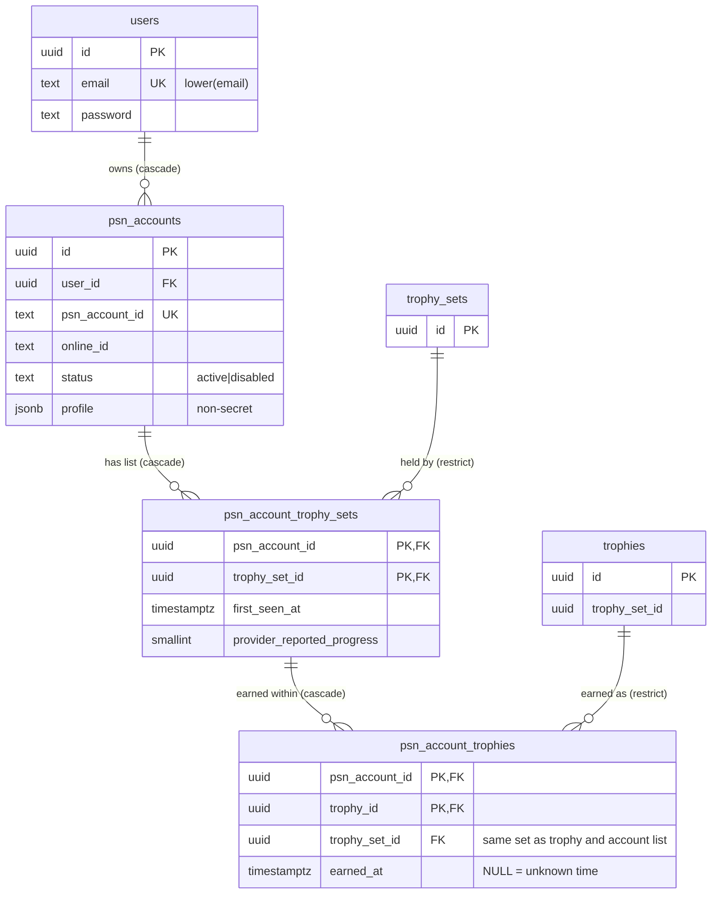
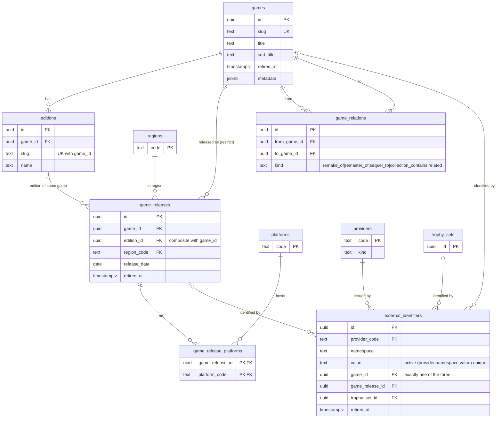
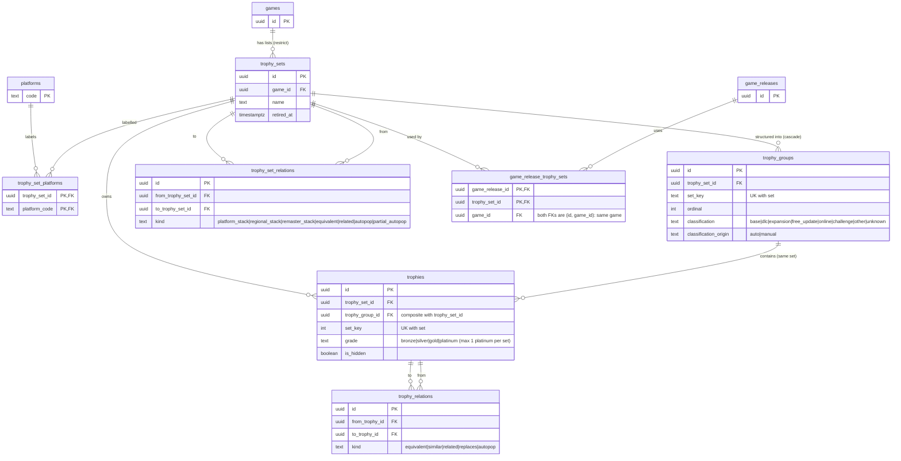
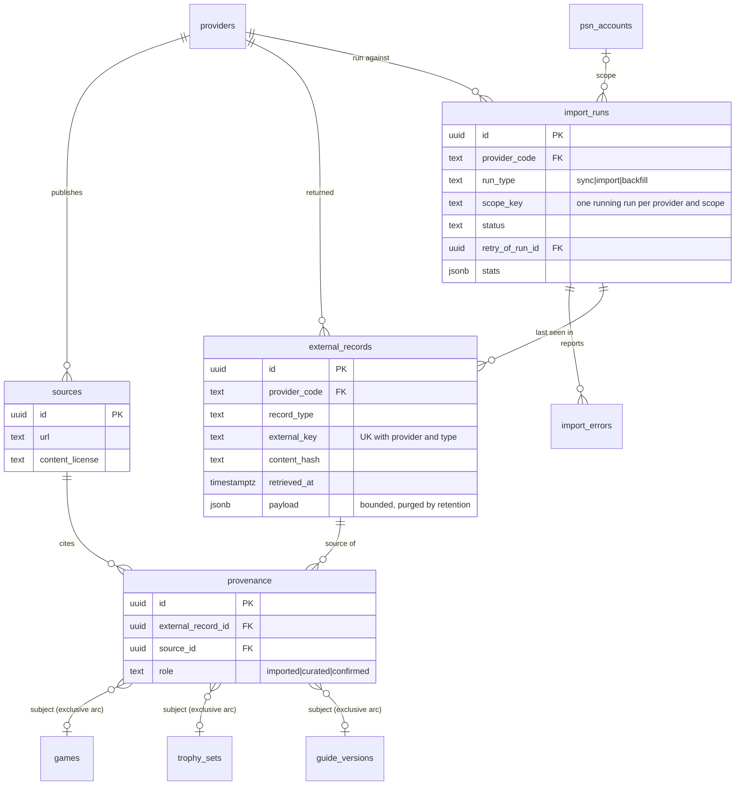
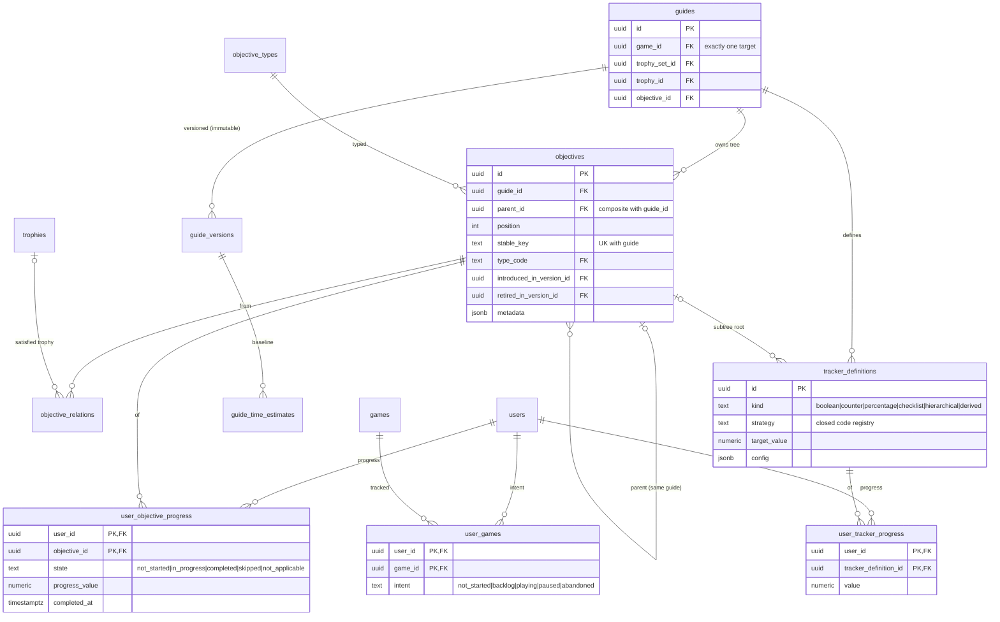
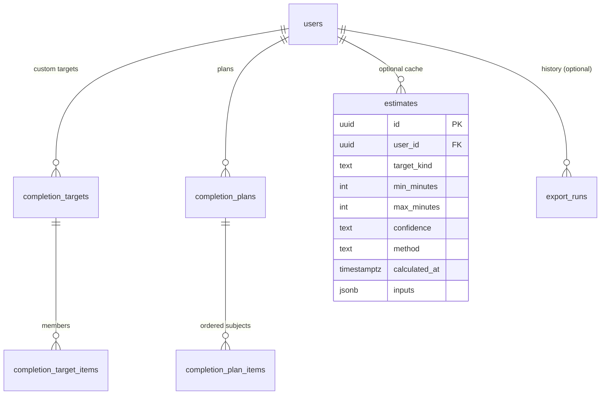

# ER diagrams

Mermaid (text-based; renders on GitHub). Each diagram is one domain; cross-domain references are shown as entities with only their key. `PK`/`FK`/`UK` as usual.
Entities marked *(planned)* in the section text are not migrated yet. Without a render tool, read the relationship lines: `A ||--o{ B` = one A has zero-or-more B.

## 1. Identity and player progress (physical)

## 2. Catalog (physical)

## 3. Trophy structure and its link to the catalog (physical)

## 4. Provenance and sync (planned, M2 — [ADR 0010](../decisions/0010-provenance-and-sync-model.md))

## 5. Knowledge and personal completion (planned, M4/M5 — [ADR 0013](../decisions/0013-objectives-trackers-guides.md))

## 6. Planning and export (planned, M7/M8)

